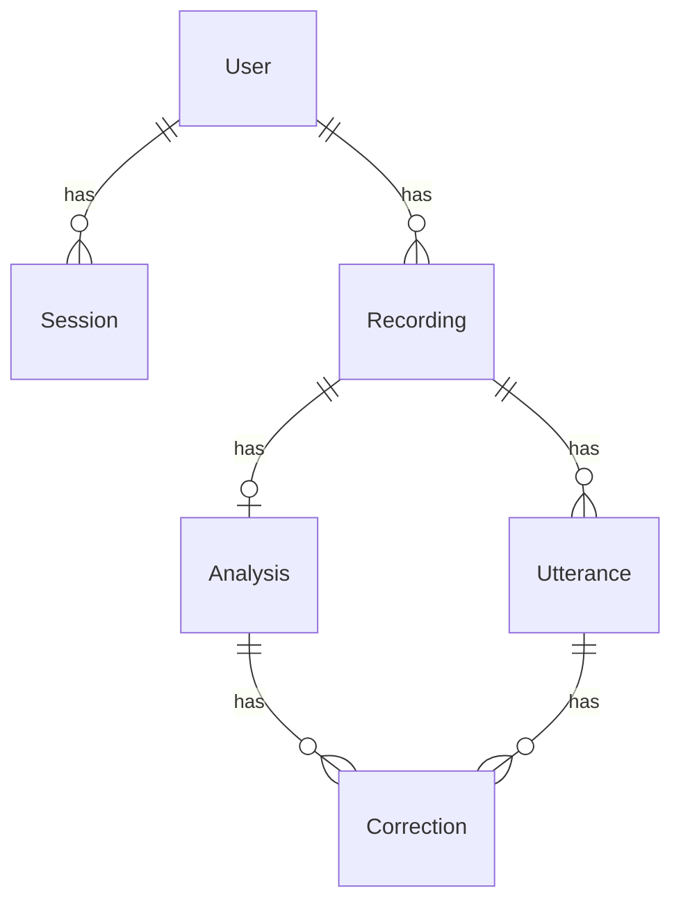

# Data Model

- **Status:** Agreed (2026-10-28). Columns may still be added as features are built.

## Tables

### User
Created by Rails 8's authentication generator (`email_address`, `password_digest`) plus
its `Session` model.

### Recording

| Column | Type | Notes |
|---|---|---|
| `user_id` | references | |
| `audio` | Active Storage attachment | `has_one_attached :audio` (no column) |
| `status` | string, enum | `uploaded` / `transcribing` / `awaiting_speaker` / `analyzing` / `completed` / `failed` |
| `error_message` | string | Shown to the user when `failed` |
| `stt_request_id` | string | Deepgram request ID, for debugging |
| `duration_seconds` | decimal | From Deepgram's `metadata.duration`, not from the browser |
| `my_speaker` | integer, null | Set when the user picks "I am speaker A" |
| `consent_confirmed_at` | datetime, not null | Recording is not accepted without consent |
| `delete_audio_after_transcription` | boolean, default true | Privacy option |
| `discard_others_utterances` | boolean, default true | Privacy option |
| `audio_deleted_at` | datetime | |

### Utterance

| Column | Type | Notes |
|---|---|---|
| `recording_id` | references | |
| `speaker` | integer | Deepgram's speaker index (0, 1, …). Shown as "Speaker A", "B", … |
| `text` | text | |
| `start_ms`, `end_ms` | integer | |

Index: `(recording_id, start_ms)`.

### Analysis

| Column | Type | Notes |
|---|---|---|
| `recording_id` | references, unique | One analysis per recording |
| `word_stats` | jsonb | Computed in Ruby |
| `filler_stats` | jsonb | Computed in Ruby |
| `status` | string, enum | Tracks the LLM step separately (see below) |

### Correction

| Column | Type | Notes |
|---|---|---|
| `analysis_id` | references | |
| `utterance_id` | references | |
| `original`, `corrected` | text | |
| `explanation` | text | |
| `suggested_expression` | text, null | |
| `category` | string | `grammar` / `naturalness` / … |

Stored as rows (not jsonb) so the Phase 3 review feature can query them.

## Decisions made during review

- **No `Utterance.mine` column.** It would duplicate `Recording.my_speaker`, and the two
  could disagree after the user re-picks a speaker. "My utterances" is a scope that joins
  on `utterances.speaker = recordings.my_speaker`.
- **`speaker` is an integer**, matching Deepgram's response. Labels like "Speaker A" are a
  view concern.
- **`Analysis.status` is kept** even though `Recording.status` covers the overall flow.
  Word and filler stats are deterministic, but the LLM step can fail on its own; this lets
  us show stats with a "corrections failed" notice instead of failing the whole recording.
- **Status enums are string-backed** so rows are readable in `psql` and the order of
  values can change without a data migration.
- **No `language` column** for now: analysis is English-only (CLAUDE.md §5).
- **No column for the daily limit:** count today's recordings with
  `user.recordings.where(created_at: Time.current.all_day).count`.
- **`duration_seconds` comes from Deepgram**, because values sent by the browser can be
  tampered with. The 5-minute limit is enforced in the browser for UX and by file size on
  the server.
